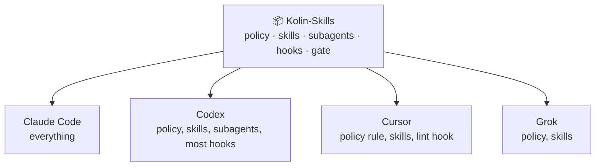
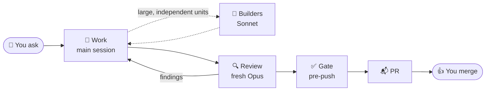

<div align="center">

# Kolin-Skills

**One rule book for every coding agent you use.**

Claude Code, Codex, Cursor and Grok follow the same rules, skills and guardrails, from one repo.


[What](#what-it-is) · [Why](#why-use-it) · [How it works](#how-it-works) · [Install](#install) · [Quality](#what-quality-means) · [Daily use](#working-with-it) · [Skills](#skills)

</div>

## What it is

One repo holds your agent setup. Each tool's home folder only links to it, so one edit reaches every tool.



| Part | What it gives you |
|---|---|
| 📜 **Policy** | A short rule book: only what a model gets wrong untold — approvals, code preferences, security, done, PR format |
| 🧰 **Skills** | Playbooks that load when your request matches: fix a bug, audit a repo, polish a UI |
| 🤖 **Subagents** | A builder, a reviewer and a sweeper. The builder never reviews its own code |
| 🛡️ **Guardrails** | Hooks that block a risky action before it runs |
| ✅ **Gate** | `kolin-skills check`, run on pre-commit (file length), pre-push, and Linux CI |

## Why use it

| Without it | With it |
|---|---|
| Each tool has its own rules file | One rule book in every tool |
| A rule in a prompt is only a request | A hook blocks the action, and the gate fails the push |
| The agent reviews its own code | A fresh reviewer reads every diff |
| "Done" means it compiles | "Done" means proven on the real app |
| The same mistake comes back | A mistake seen twice, or once for security, data-loss, or irreversible classes, becomes a lint rule, a test or a type |

## How it works

Most tasks run in the main session. A large task with independent units adds builders.



The models are the Claude Code seats. Codex runs both subagents on its default model.

**Guardrails block. They do not ask.** The blocked agent gets the reason and the fix.

| 🚫 Blocked | Why |
|---|---|
| Push to `main`, `master`, `staging`, `sandbox`; force push; `--no-verify`; auto-merge | Protected branches change only through a PR you merge. An agent may create a missing one with `gh api repos/<owner>/<repo>/git/refs -f ref=refs/heads/staging -f sha=<sha>`; GitHub rejects it if the branch exists. Moving or deleting one through the API is blocked |
| Reading a `.env` file | Secrets stay out of the context |
| Sleep loops, filtered gate output (a trailing filter is stripped; one that cannot be stripped safely is blocked) | Agents see the real output and use the real tools |

Claude Code runs every guard. Codex runs the git and `.env` guards. Cursor runs only the lint hook, and Grok runs no hooks.

## Install

You need **git**, **`jq`**, **Python ≥ 3.9** and **Node ≥ 22.20**. Without `jq`, the git guard blocks every shell command. The repo is public, so the clone needs no credentials.

```sh
git clone https://github.com/kolin-HJ/Kolin-Skills.git ~/Kolin-Skills
python3 ~/Kolin-Skills/bin/kolin-skills install
```

1. **Run `install` once.** It fetches the pinned third-party skills, links everything into each tool, runs `check` and puts `kolin-skills` in `~/.local/bin`.
2. **Open any agent in any repo.** There is nothing to start.
3. **Updates come by themselves.** Each Claude Code and Codex session pulls the latest `main`, as long as the clone has no local edits. When an update moves a third-party pin, run `kolin-skills upstream`.
4. **Put your own rules in each project's `AGENTS.md`.** Do not edit the clone, because a local edit stops the updates.

With Node older than 22.20, `install` skips the third-party skills and says so. Offline, it links what it has and exits 1.

### Rewire onto current main

An old install keeps its old hooks until home is wired to a checkout on current `main`. Those hooks can block commands that current `main` allows: without `jq` the git guard blocks every shell command, and an old lint hook blocked metric findings that now only report. Do not change hook behavior to work around that. Rewire.

`apply` writes into `$HOME`. Use the account the agents on that machine use. Invoke the CLI from the checkout on current `main`, not `kolin-skills` on `PATH`, which may still be the old symlink. A worktree is the wrong checkout; `pull` only updates the wired clone, and only when it is clean `main`.

```sh
cd ~/Kolin-Skills
git fetch origin
git switch main
git merge --ff-only origin/main
python3 "$PWD/bin/kolin-skills" apply --adopt
python3 "$PWD/bin/kolin-skills" check
```

`--adopt` is required when `~/.kolin-skills/state.json` names a different checkout. Skip it when this checkout already owns home. `install` is only the first run on a machine (it also fetches third-party skills).

Confirm:

1. `jq -r .repo ~/.kolin-skills/state.json` is this checkout's absolute path.
2. `git -C "$(jq -r .repo ~/.kolin-skills/state.json)" rev-parse HEAD origin/main` prints the same SHA twice.
3. `check` prints `Passed:`.

## What quality means

> **The most value for the least code**, at the same bar for correctness, tests and proof.

| Bar | Check |
|---|---|
| 🎯 **Earns its place** | Every file, test and dependency answers "what breaks if this goes?" |
| ✂️ **Small** | The smallest change that fixes the root cause. Files near 400 lines, never over 1,000 |
| 📁 **Feature-first** | One folder per feature, one shape for every feature, a file and line budget per feature |
| 🏠 **One home** | One concept lives in one module. Extend the owner, no parallel helper |
| 🔒 **Typed** | Strict mode. No `any`, no cast, no non-null assertion |
| 🧪 **Tested** | Each behavior a caller relies on. The test fails first, then fails again on a one-line mutation |
| 👀 **Reviewed** | By an agent that did not write the code |
| 📸 **Proven** | Run on the real app, with the output pasted |

Each lesson goes into the strongest layer that can hold it:

```
 strongest ─▶  1. Code that makes the bad state impossible (a type, one paved path)
               2. A gate: a lint rule or test, with a count that can only fall
               3. A skill or AGENTS.md, for judgment no tool can check
 weakest ───▶  4. Review
```

The full bar: [`policy/AGENTS.md`](policy/AGENTS.md) and [`skills/foundation/SKILL.md`](skills/foundation/SKILL.md).

## Working with it

Ask for the outcome in plain words, such as "fix the redirect bug on login". The agent picks the skill, does the reversible work alone and waits for you only at the points that matter.

| 🤖 The agent does it alone | 🙋 It waits for your yes |
|---|---|
| Read, edit, test, review, fix | A multi-phase plan, before the build |
| Commit, push and open a PR on a work branch | A new data structure or system flow |
| | A merge, a deploy, a migration |
| | Money, secrets, messages to people |

You can also call any skill by name, such as `/gap-audit`.

## Skills

Each skill starts in one of three ways:

| | How it starts |
|---|---|
| 💬 **On match** | The agent loads it when your request matches its description |
| ⌨️ **You only** | Only you can start it, by phrase or slash command. In Claude Code, the agent cannot start it by itself |

**Core**

| Skill | Starts | What it does |
|---|---|---|
| `foundation` | 💬 | Large work: the flow, the extra approval points, the quality bars, layout budgets and the UI bar |
| `pstack-local` | 💬 | Maps pstack onto each tool when a pstack skill runs: model seats, `diff-audit`, `pr-body` |
| `poteto-mode` (pstack) | ⌨️ | Playbooks for feature, bug fix, refactor, review and shipping, when you ask for them |

**Process**

| Skill | Starts | Say | What it does |
|---|---|---|---|
| `gap-audit` | 💬 | "Audit this repo", "bring it up to standard" | Ranks a repo's gaps against `foundation`, then closes them in small verified steps |
| `full-stop` | ⌨️ | "full stop" or `/full-stop` | Takes one task to a PR that is ready to merge. You merge |
| `full-send` | ⌨️ | "full send" or `/full-send` | Does all of `full-stop`, then merges that one PR after a 7-item merge gate. It never deploys |
| `council` | ⌨️ | "council" or `/council` | Gets a review from three models on three providers, in rounds, until they agree. Scores go in the PR body |
| `modernize` | 💬 | "Modernize this PR", "take over #42" | Decides if an old PR should still land (modernize, rework or close), then updates it and keeps the authors' credit |
| `loop-refactor-to-pstack` | ⌨️ | `/loop-refactor-to-pstack` | Refactors a whole repo to the standard over many sessions on one branch |

**UI craft**

| Skill | Starts | Say | What it does |
|---|---|---|---|
| `break-ui` | 💬 | "Stress-test this table" | Feeds worst-case data to a UI and reports what broke |
| `emil-design-eng` | 💬 | "Make this drawer feel polished" | Motion and polish: easing, springs, transitions, gestures |
| `mobile-native` | 💬 | "It feels wrong on my phone" | Fixes the tells that make a web app feel like a website on a phone |

**Utilities**

| Skill | Starts | Say | What it does |
|---|---|---|---|
| `local-supabase` | 💬 | "Start a local database" | Runs a local Supabase or Postgres per checkout, never in Docker |
| `user-notes` | 💬 | "Write release notes for PR 42" | Writes short release notes for the people who use the app |
| `explainer` | 💬 | "Explain this PR visually" | Builds a one-page HTML explainer. Only when you ask or say yes to the offer |

**Subagents.** The main agent spawns these. You do not call them.

| Agent | Model | Spawned when |
|---|---|---|
| `poteto-agent` | Sonnet | A large, independent unit of code can run in parallel with other work |
| `senior-reviewer` | Opus | A non-trivial diff is ready, before a commit or PR |
| `haiku-worker` | Haiku | A mechanical sweep: a rename, a codemod, a read-only search |

<details>
<summary><b>Third-party skills that install also adds</b></summary>

| Source | Skills | Starts |
|---|---|---|
| [pstack](https://github.com/cursor/plugins) | `how`, `architect`, `interrogate`, `swarm`, `arena`, `tdd`, `unslop`, `technical-writing`, `no-comments`, `correct` and the `principle-*` skills | The agent reads one when a task or playbook needs it. You can type `/poteto-mode`, `/how` and the rest |
| cursor-team-kit | `deslop`, `control-ui`, `control-cli` | 💬 To clean AI slop out of code, or to drive a UI or CLI |
| cursor-team-kit | `thermo-nuclear-code-quality-review` | The agent reads it for the diff pass before review, or when you ask for a harsh structure review |
| `npx skills` | `find-skills` | ⌨️ |

</details>

## Reference

<details>
<summary><b>Layout</b></summary>

```
policy/AGENTS.md             global policy → ~/.claude/CLAUDE.md, ~/.codex/AGENTS.md, ~/.grok/AGENTS.md
policy/compact-instructions.md   what a compaction summary keeps
skills/                      own skills, linked flat into ~/.agents/skills, ~/.claude/skills, ~/.cursor/skills
  pstack-local/models.md     which model plans, builds and reviews
agents/                      subagents; senior-reviewer.md holds the review bar
hooks/                       guards and lint, run in place from the repo
claude/                      managed settings keys, status line, output style (ste-visual)
codex/, cursor/              hook config and the Cursor policy rule
.githooks/                   pre-commit runs check --files; pre-push runs check; post-merge, post-checkout, post-rewrite run apply
upstream/                    pstack and cursor-team-kit (vendor.json), npx skills (skills.json)
tests/                       installer, hook and repo-rule tests, run by check
```

Edits to existing files are live at once. A new, renamed or deleted skill or agent needs `apply`, which runs by itself at session start and after `git pull`, `checkout` and `rebase` here. `apply` is idempotent, and a real file it replaces goes to `~/.kolin-skills/backup/`.

Project rules live in each project's own `AGENTS.md`, never here. Not managed: credentials, Codex `config.toml`, Cursor `mcp.json`, and `permissions` and `autoMode` in `~/.claude/settings.json`.

</details>

<details>
<summary><b>Commands</b></summary>

| Command | What it does |
|---|---|
| `kolin-skills install` | First run on a machine: `upstream`, then `check` |
| `kolin-skills apply` | Links the repo into home. `--check` reports drift only. `--adopt` moves home to this checkout. `--if-wired` runs only when home is wired here |
| `kolin-skills pull` | Fetches `origin/main`, fast-forwards when it safely can, then applies. Runs at each Claude Code and Codex session start, and prints `kolin-skills: stale setup` when it cannot update |
| `kolin-skills upstream` | Installs third-party skills at pinned commits. `--bump` moves the pins |
| `kolin-skills import <path>` | Moves a skill or agent made in home into the repo |
| `kolin-skills check` | The gate: drift, strays, pins, spend caps, size budgets, 1,000-line files, tools, tests, comments. `--files` is only the line limit. Prints `feature-budget` and does not fail on it. In a worktree it skips home drift. In CI it skips home and vendor |
| `context-audit` | Lists skills, tools and MCP servers that cost context and went unused for 30 days. `--sessions [DAYS]` reports token use, hook blocks and failing tools across recent transcripts |
| `feature-budget` | Counts files and lines under `features/<name>/` against the plan (defaults: read 5/800, edit 7/1,200, write 12/2,500, tests excluded). Lists under-40-line single-importer files except a library wrapper. Report-only in `kolin-skills check`. Over budget fails review; over twice the budget stops the wave (`foundation`, "Where Kolin steps in") |

</details>

<details>
<summary><b>Hooks</b></summary>

| Hook | Tools | Does |
|---|---|---|
| `hooks/gate/block-forbidden-git.sh` | Claude Code, Codex | Blocks protected-branch pushes and merges, force push, `--no-verify`, auto-merge, edits to hook files |
| `hooks/block-env-reads.py` | Claude Code, Codex | Blocks `.env` reads. `.env.example` stays readable |
| `hooks/agent-default-model.py` | Claude Code | Blocks editing subagents spawned with `isolation: "worktree"`. Denies Opus on an editing subagent and names `Plan`. Runs `senior-reviewer` on Opus when a repo copy pins lower |
| `hooks/bash-guard.py` | Claude Code | Guards each Bash command: blocks polling loops, Docker databases and long curl retries, strips or rewrites filters on gate output and never blocks them, and queues heavy jobs into 3 shared slots |
| `hooks/context-budget.py` | Claude Code | In a subagent, warns at 200,000 context tokens to wrap up and blocks at 260,000 until it reports |
| `hooks/mcp-access.py` | Claude Code | When an MCP tool fails with an access error, tells the agent this account lacks the connector, to stop calling it and to use the CLI |
| `hooks/lint-changed-lines.py` | All but Grok | Lints the JS and TS lines the agent just changed |
| `hooks/compact-context.py` | Claude Code, Codex | Keeps the branch and changed files through compaction |

</details>

## Credits

The method is [pstack](https://github.com/cursor/plugins) by Lauren Tan, with skills from Cursor's cursor-team-kit. Both are vendored at pinned commits in `upstream/vendor.json`, never copied. `emil-design-eng` follows Emil Kowalski's UI craft. `council`, `modernize` and the babysit and review-scope rules in `full-stop` adapt Theo Browne's [tstack](https://github.com/t3dotgg/tstack).
