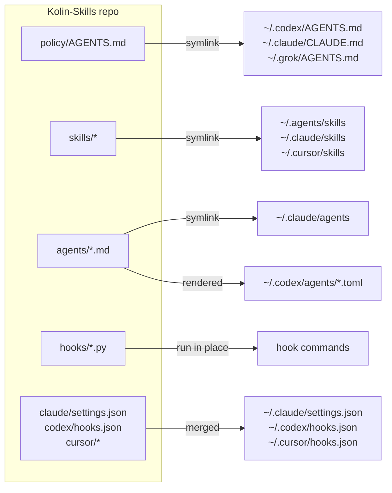

# Kolin-Skills

One repo for Kolin's agent setup. Change a file here and every harness on the machine (Claude Code, Codex, Cursor, Grok) uses the change.

## Where the workflow is written down

| Question | Source of truth |
|---|---|
| How every agent works for Kolin: approvals, quality bar, tests, PRs, writing | `policy/AGENTS.md` |
| Which method and playbook to follow (pstack), and how it maps to each harness | `skills/pstack-local/SKILL.md` |
| Which model runs each subagent role | `skills/pstack-local/models.md` |
| Review bar for every diff | `agents/senior-reviewer.md` |
| Reply style in Claude Code | `claude/output-styles/ste-visual.md` |
| What a compaction summary keeps | `policy/compact-instructions.md` |
| Approval shortcuts "full stop" and "full send" | `skills/full-stop/`, `skills/full-send/` |

## How a change reaches each harness



- **Edits to existing files are live at once.** Home paths are symlinks into this repo.
- **New, renamed or deleted skills and agents, and settings changes** need `kolin-skills apply`. It runs by itself:
  - at the start of each Claude Code and Codex session (`kolin-skills pull`, which fast-forwards from GitHub first when the repo has no local edits),
  - after `git pull`, `git checkout` and `git rebase` in this repo (`.githooks/`).
- `apply` is idempotent. A second run prints `already in sync`. A real file it replaces goes to `~/.kolin-skills/backup/<time>/`.

## New machine

```sh
git clone https://github.com/kolin-HJ/Kolin-Skills.git ~/Documents/Github/Kolin-Skills
python3 ~/Documents/Github/Kolin-Skills/bin/kolin-skills install
```

`install` clones the vendored upstreams, installs third-party skills, runs `apply`, then `check`. It links the CLI to `~/.local/bin/kolin-skills`, so the command works wherever `~/.local/bin` is on `PATH`.

## Commands

| Command | What it does |
|---|---|
| `kolin-skills apply` | Links and renders the repo into home. Offline. `--check` reports drift and changes nothing. |
| `kolin-skills pull` | Fast-forwards from the remote when the tree is clean, then applies. The session-start hook runs this. |
| `kolin-skills upstream` | Updates pstack, cursor-team-kit, ponytail and the `npx skills` packages, then applies. |
| `kolin-skills check` | The gate: drift, spend caps, size budgets, Bun, tests. |
| `kolin-skills install` | First run on a machine: `upstream`, then `check`. |

## Layout

| Path | Owns | Lands at |
|---|---|---|
| `policy/AGENTS.md` | Global policy for every harness | `~/.codex/AGENTS.md`, `~/.claude/CLAUDE.md`, `~/.grok/AGENTS.md` |
| `policy/compact-instructions.md` | Compaction brief | `~/.codex/compact-instructions.md` |
| `skills/` | Own skills, including the `pstack-local` adapter | `~/.agents/skills`, `~/.claude/skills`, `~/.cursor/skills` |
| `agents/` | Subagents | `~/.claude/agents`, `~/.codex/agents/*.toml` |
| `hooks/` | Hook scripts | Run from the repo; old home paths stay as links |
| `claude/` | Managed settings keys, status line, output style | `~/.claude/` |
| `codex/`, `cursor/` | Hook config and the Cursor policy rule | `~/.codex/hooks.json`, `~/.cursor/` |
| `mods/` | Claude Code mods `usage-band` and `savvy-progress` | `~/.claude/mods/` |
| `evals/` | Agent eval cases and results | `~/.agents/evals` |
| `upstream/` | Vendored and third-party skill sources | `~/.agents/vendor`, `npx skills` |
| `tests/` | Hook and apply tests | Run by `check` |

## Not managed

- Codex `config.toml`, Cursor `mcp.json` and every credential file. They hold machine paths and secrets.
- `permissions` and `autoMode` in `~/.claude/settings.json`. They are per machine and per project.
- herdr's hooks, REA's `reverse-engineer-anything` skill and claude.ai synced skills. Their installers own them.
