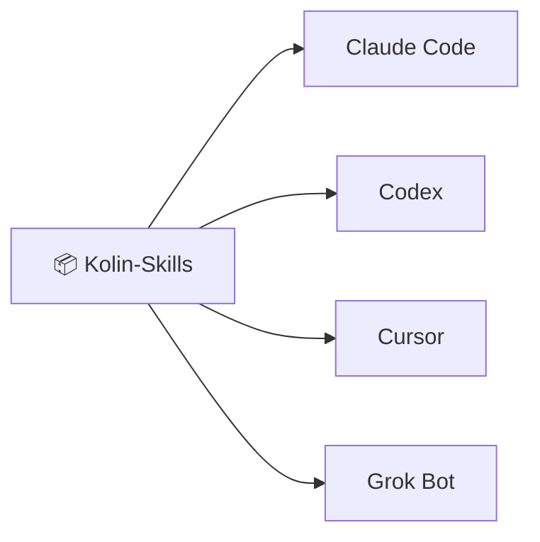

<div align="center">

# Kolin-Skills

**One rule book for every coding agent I use.**

Claude Code, Codex, Cursor and Grok Bot all get the same rules, skills, helpers and safety checks from this one repo.


[What it is](#what-it-is) · [What's inside](#whats-inside) · [Install](#install) · [How work runs](#how-work-runs) · [Guardrails](#guardrails) · [Skills](#skills) · [Tools](#what-each-tool-gets) · [Change this repo](#change-this-repo) · [Reference](#reference)

</div>

## What it is

Every coding agent reads setup files from a folder in your home directory: rules, skills, helper agents and hooks. Without this repo, each tool has its own copy, and the copies drift apart.

This repo is the one real copy. A single command links each tool's home folder back to it. Change a file here, and every tool sees the change.

> Think of it like one master playlist that every speaker in the house plays from, instead of a separate CD in each room.



It is built on [pstack](https://github.com/cursor/plugins), Lauren Tan's method for agent work. pstack says *how* to plan, build, review and ship. This repo adds only what pstack does not cover: my approval rules, my code preferences, a few skills of my own, and hooks that enforce the rules instead of only asking.

## What's inside

| Part | Folder | What it does |
|---|---|---|
| 📜 **Policy** | `policy/` | The short rule book every agent loads at the start of a session: when to ask me first, code style, security, what "done" means, and PR format |
| 🧰 **Skills** | `skills/` | Extra know-how an agent loads when a task needs it, such as running a local database or writing release notes |
| 🤖 **Subagents** | `agents/` | Helper agents the main agent can start: a builder, a judge and a reviewer |
| 🛡️ **Hooks** | `hooks/` | Small scripts that run around each agent action. They block risky actions and lint changed code |
| ⚙️ **Tool settings** | `claude/`, `codex/`, `cursor/` | Each tool's managed settings, hook wiring, status line and reply style |
| 📦 **Third-party pins** | `upstream/` | The exact versions of pstack, other skill packs and CLIs to install. They are installed, never copied in |
| 🧪 **Gate** | `bin/`, `tests/`, `.githooks/` | The `kolin-skills` CLI, small helper CLIs, and the tests that must pass before a push |
| 📚 **Docs** | `docs/` | How to keep a machine on `main`, and how to check other repos for drift |

## Install

You need **git**, **`jq`**, **Python 3.9+** and **Node 22.20+**, with a global npm folder you can write to (Homebrew, nvm, fnm or Volta Node all work). The repo is public, so the clone needs no login.

```sh
git clone https://github.com/kolin-HJ/Kolin-Skills.git ~/Kolin-Skills
python3 ~/Kolin-Skills/bin/kolin-skills install
```

What `install` does:

1. Installs pstack, the other third-party skills and the CLIs at their pinned versions.
2. Links the repo into each tool's home folder.
3. Puts `kolin-skills` and the helper CLIs in `~/.local/bin`.
4. Runs `kolin-skills check` to prove the setup works.

Then open any agent in any repo. There is nothing to start.

Good to know:

- **Keep the clone where it is.** The home folders link into it.
- **Do not edit the clone.** Local edits stop automatic updates. Put project rules in that project's own `AGENTS.md`.
- **Node older than 22.20:** `install` skips the third-party parts and says so.
- **Offline:** `install` links what it has and exits with code 1.

## Install (for agents)

Given this repo's URL and "install this", run these steps in order. Stop at the first failure and read its message.

```sh
for tool in git jq python3 node; do command -v "$tool" >/dev/null || echo "missing: $tool"; done
python3 -c 'import sys; assert sys.version_info >= (3, 9), sys.version'
node -e 'const [major, minor] = process.versions.node.split(".").map(Number); if (major < 22 || (major === 22 && minor < 20)) process.exit(1)'
CLONE="${KOLIN_SKILLS_DIR:-$HOME/Kolin-Skills}"
git clone https://github.com/kolin-HJ/Kolin-Skills.git "$CLONE"
python3 "$CLONE/bin/kolin-skills" install
export PATH="$HOME/.local/bin:$PATH"
kolin-skills check --quick
```

Keep the clone where it is, because the home folders link into it. `check --quick` takes a few seconds. It passes only when every link resolves, the hooks and policy are wired, and the pstack skills that must start on their own (`poteto-mode`, `how`, `architect`, `tdd`, `interrogate`, `correct` and the `principle-*` skills) have no `disable-model-invocation` line. Then start a new session: a running agent keeps the skills and policy it loaded at start.

## How work runs

Ask for the outcome in plain words, such as "fix the redirect bug on login". The agent picks the right skill and does the work.

1. The main agent plans and builds in the same session.
2. For a large task with independent parts, it can start builder subagents.
3. It proves the change on the real thing: it runs the gate, the tests and the app.
4. It opens a PR with a `## Verification` section that lists what it ran.
5. I read the PR and merge it.

A reviewer subagent runs only on high-risk work (auth, money, data deletion) or when I ask. Proof that the change works is the quality bar, not a second AI reading the diff.

**What the agent does alone, and what waits for my yes:**

| 🤖 Does it alone | 🙋 Waits for my yes |
|---|---|
| Read, edit, run, test, review, fix | A plan with more than one phase, before the build |
| Commit, push and open a PR on a work branch | A new or changed data shape (type, table, schema) or system flow |
| Delete or refactor code it touches | A merge, a deploy, a release or a migration |
| | Money, secrets, and messages to people |

The full rules are in [`policy/AGENTS.md`](policy/AGENTS.md).

**How a lesson becomes a rule.** When the same mistake costs real time twice (or once, for security, data loss or something that cannot be undone), it goes into the strongest place that can hold it:

1. Code that makes the mistake impossible, such as a type.
2. A gate: a lint rule or a test that fails the push.
3. A skill or `AGENTS.md` line, for judgment no tool can check.
4. Review, as the last resort.

## Guardrails

Hooks block an action and tell the agent why and what to do instead. They do not ask.

| 🚫 Blocked | Why |
|---|---|
| Push to `main`, `master`, `staging`, `sandbox`; force push; `--no-verify`; auto-merge; API merges | Protected branches change only through a PR. Agents may merge a PR into `staging`. A merge into `main`, `master` or `sandbox` needs me. An agent may create a missing protected branch with `gh api repos/<owner>/<repo>/git/refs -f ref=refs/heads/staging -f sha=<sha>`; GitHub rejects it if the branch exists. Moving or deleting one through the API is blocked |
| Reading a `.env` file | Secrets stay out of the agent's context. `.env.example` stays readable |
| Starting a database in Docker | Agents use the native Supabase CLI instead (see `local-supabase`) |
| Marking a PR ready with no `## Verification`, or with a reward hack such as a skipped test | The PR goes back to draft, so a PR with no proof does not reach me |

Other hooks help instead of block: they lint the JS and TS lines the agent just changed, keep the branch and changed files through context compaction, keep the Mac awake during long turns, and share heavy jobs across 3 slots so parallel agents do not overload the machine.

**What is not blocked.** Nothing stops an agent from merging a PR into `staging`. GitHub branch protection is still the real lock for `main`. The PR check also catches *missing* proof, not *false* proof, so read the diff on anything that matters.

## Skills

A skill starts in one of three ways:

- 💬 **On match:** the agent loads it when the request matches its description.
- ⌨️ **You only:** only you can start it, with its phrase or slash command.
- 📜 **By policy:** the policy sends matching work to it.

**My skills** (in `skills/`)

| Skill | Starts | What it does |
|---|---|---|
| `pstack-local` | 💬 | Adapts pstack to each tool on this machine: tool names, paths, which model does which job, and where my policy wins |
| `repo-standard` | 💬 | My bar for a finished repo: layout, size budgets, quality bars, gate design, the UI bar, and a checklist to audit a repo |
| `full-send` | ⌨️ "full send" | Takes a task all the way to a green, proven PR that is ready to merge, then stops. It never merges |
| `local-supabase` | 💬 "start a local database" | Runs a local Supabase or Postgres for each checkout, never in Docker |
| `user-notes` | 💬 "release notes for PR 42" | Asks which format I want (text, graphic or video), then writes short release notes for users |
| `explainer` | 💬 "explain this PR visually" | Builds a one-page HTML explainer, only when asked |
| `council` | 💬 "council" | Gets a review from four model families at once (Claude, GPT, Muse and Grok) and loops until they agree. Adapted from [tstack](https://github.com/t3dotgg/tstack) (MIT) |
| `hydrojug-untangle` | ⌨️ `/hydrojug-untangle` | Untangles only the files I name or the current diff, never the whole repo. Inspired by [caldoai `untangle-codebase`](https://github.com/caldoai/skills/blob/main/skills/untangle-codebase/SKILL.md) (MIT) |

**The method** comes from pstack. `poteto-mode` (📜) holds the playbooks for a feature, a bug fix, a refactor, a review and shipping. The policy sends any code work bigger than a one-line change to it.

**Subagents** (in `agents/`). The main agent starts these. You do not call them.

| Agent | Model | Used for |
|---|---|---|
| `poteto-agent` | Sonnet | Building a large, independent piece of code in parallel with other work |
| `judge` | Opus, or Fable 5.2 for architecture planning | One design or judgment call. It cannot edit files, and unlike the built-in `Plan` agent, it loads my policy |
| `senior-reviewer` | Opus | A fresh-eyes diff review, only on high-risk work or when asked |

<details>
<summary><b>Third-party skills that <code>install</code> adds</b></summary>

These are pinned in `upstream/` and installed by `kolin-skills upstream`. They are never copied into this repo.

| Source | Skills | When they start |
|---|---|---|
| [pstack](https://github.com/cursor/plugins) | `poteto-mode`, `how`, `why`, `teach`, `architect`, `interrogate`, `swarm`, `arena`, `tdd`, `unslop`, `technical-writing`, `no-comments`, `correct`, `statechart`, the `principle-*` skills and more | When a task or playbook needs one. You can also type `/how`, `/architect` and the rest |
| cursor-team-kit | `deslop`, `control-ui`, `control-cli` | 💬 To clean AI slop out of code, or to drive a web UI or a CLI |
| cursor-team-kit | `thermo-nuclear-code-quality-review` | High-risk work, or when you ask for a harsh structure review |
| `npx skills` | `find-skills` | ⌨️ |
| `npx skills` | `agent-browser` | To drive or check a web app. `upstream` also installs its CLI |
| `npx skills` | `agent-desktop` | To drive or check a native desktop app. `upstream` also installs its CLI. On macOS, grant Accessibility once with `agent-desktop permissions --guide` |
| `npx skills` | `hyperframes`, `hyperframes-cli`, `hyperframes-registry`, `media-use`, `slideshow`, `reverse-any-video`, `style-sampling` | To make app demo and training videos. Sign in with `hyperframes auth login` for free music, sound effects and stock media |

</details>

## What each tool gets

Claude Code gets everything. The other tools get what they can support.

| | Claude Code | Codex | Cursor | Grok Bot |
|---|---|---|---|---|
| Policy | ✅ | ✅ | ✅ as an always-on rule | ✅ |
| Own skills | ✅ | ✅ | ✅ | ✅ |
| Subagents | ✅ | ✅ (written as `.toml`) | — | — |
| `.env` guard | ✅ | ✅ shell commands only | — | — |
| PR proof check | ✅ | ✅ | — | — |
| Lint on changed lines | ✅ | ✅ | ✅ | — |
| Other hooks, status line, reply style | ✅ | — | — | — |
| Updates itself at session start | ✅ | ✅ | — | — |

**Staying up to date.** Claude Code and Codex run `kolin-skills pull` when a session starts. It fast-forwards the clone to `origin/main` and re-links home. Cursor and Grok Bot have no session-start hook, so they keep whatever the last `apply` linked. To update any machine by hand, follow [`docs/stay-on-main.md`](docs/stay-on-main.md). When an update moves a third-party pin, run `kolin-skills upstream`.

`pull` skips a clone that has local edits or is not on `main`, and prints `kolin-skills: stale setup` so you know.

## Change this repo

Work in a git worktree, not the main clone. The main clone is live for every session on the machine, so switching its branch changes every agent at once.

| To add | Put it in | Then |
|---|---|---|
| A skill | `skills/<name>/SKILL.md`, plus a row in this README | Run `kolin-skills apply`, or start a new session |
| A subagent | `agents/<name>.md` | Run `apply`. It links the agent for Claude and writes the Codex `.toml` copy |
| A hook | `hooks/<name>.py`, plus an entry in `claude/settings.json` or `codex/hooks.json` | Add a test to `tests/test_hooks.py` if the hook can block work or lose data |
| A third-party skill | `upstream/skills.json` | Run `kolin-skills upstream` |
| A skill another tool wrote into home | Nowhere by hand | Run `kolin-skills import <path>` to move it here |

Rules that keep it working on every machine:

- Never write a skill, agent or rule straight into a home folder. `check` fails on it.
- Use `{{HOME}}` and `{{REPO}}` in hook commands. Never commit a real home path.
- No secrets in this repo: no tokens, `auth.json`, MCP credentials or `.env` values.
- Nothing project-specific. Project rules go in that project's `AGENTS.md`.

**The gate** is `kolin-skills check`. It runs before each push and in Linux CI. Before each commit, a quick version checks that no file is over 1,000 lines. Every failure prints its fix. Agent-facing rules for this repo are in [`AGENTS.md`](AGENTS.md).

## Reference

<details>
<summary><b>Where each file goes in home</b></summary>

| In this repo | Linked or written to |
|---|---|
| `policy/AGENTS.md` | `~/.claude/CLAUDE.md`, `~/.codex/AGENTS.md`, `~/.grok/AGENTS.md` |
| `policy/compact-instructions.md` | `~/.codex/compact-instructions.md` (what a compaction summary keeps) |
| `cursor/agent-policy.mdc` | `~/.cursor/rules/agent-policy.mdc` (an always-on rule that points at the policy) |
| `skills/*` | `~/.agents/skills`, `~/.claude/skills`, `~/.cursor/skills` |
| `agents/*` | `~/.claude/agents`, plus a `.toml` copy in `~/.codex/agents` |
| `claude/settings.json` | Merged into `~/.claude/settings.json`. Only the keys in this file are managed |
| `codex/hooks.json`, `cursor/hooks.json` | Merged into each tool's `hooks.json` |
| `codex/rules/agent-tools.rules` | `~/.codex/rules/` (runs `agent-browser-guard` outside the sandbox, asks before each `agent-desktop` call) |
| `claude/statusline.sh`, `claude/output-styles/` | `~/.claude/` (status line and the STE Visual reply style) |
| `bin/*` CLIs | `~/.local/bin` |

`apply` is safe to run again and again. If it replaces a real file, it saves the old one in `~/.kolin-skills/backup/`. Edits to existing files are live at once. A new, renamed or deleted skill or agent needs `apply`. In this clone, git hooks run `apply` after `pull`, `checkout` and `rebase`.

Not managed here: credentials, Codex `config.toml`, Cursor `mcp.json`, and `permissions` and `autoMode` in `~/.claude/settings.json`.

</details>

<details>
<summary><b>Commands</b></summary>

| Command | What it does |
|---|---|
| `kolin-skills install` | First run on a machine: `upstream`, then `apply`, then `check` |
| `kolin-skills apply` | Links the repo into home. `--check` only reports drift. `--adopt` moves home to this checkout. `--if-wired` runs only when home already points here |
| `kolin-skills pull` | Fast-forwards to `origin/main` when it safely can, then applies. Runs at Claude Code and Codex session start |
| `kolin-skills upstream` | Installs third-party skills and CLIs at their pins. `--bump` moves the git pins. Edit `upstream/tools.json` to move a CLI |
| `kolin-skills import <path>` | Moves a skill or agent made in home into this repo |
| `kolin-skills stacks` | Lists running local Supabase stacks. `--stop` stops the idle ones |
| `kolin-skills check` | The gate: drift, stray files, pins, spend caps, file length, tools, tests and comments. `--quick` checks only home, in seconds. `--files` checks only file length. In a worktree it skips home drift. In CI it skips home and vendored skills |
| `kolin-skills check-drift <path>` | Fails when another repo's copy of pstack or `senior-reviewer` differs from this repo, or its policy still demands a reviewer on every PR. See [`docs/consumer-drift.md`](docs/consumer-drift.md) |
| `pr-body <base> --feature NAME=PATHS` | Prints a PR body skeleton with a line per feature, the diff size, Cleanup & simplify, and Verification |
| `diff-audit <base>` | Flags reward hacks and slop in a diff: skipped tests, edited assertions, comments, new dependencies, growth in `AGENTS.md` |
| `feature-budget` | Counts files and lines under `features/<name>/` against the plan's budget. Report only |
| `context-audit` | Lists skills, tools and MCP servers that cost context and went unused for 30 days. `--sessions` and `--window` report tokens and list price (by model id, with Haiku 5.5's above-100K tier) per session and role, and per effort level, hook blocks and failing tools, and count a message copied into a side chat once |
| `disk-cleanup` | Dry run by default. Reports, and with `--apply` removes, merged git worktrees (`git worktree remove`, never forced), unmerged ones idle over 7 days (the branch stays), orphaned local Supabase stacks, and npm, pnpm, turbo and Docker caches. `--scan DIR` adds repos, `--json` prints rows. Writes `~/.kolin-skills/disk-cleanup.json` |
| `pglite-replay [root]` | Replays `supabase/migrations`, then `supabase/tests`, into an in-memory PGlite database |
| `agent-browser-guard <args>` | Runs `agent-browser` for Codex outside its sandbox, with a fixed list of safe commands |

</details>

<details>
<summary><b>Hooks</b></summary>

| Hook | Tools | What it does |
|---|---|---|
| `gate/block-forbidden-git.sh` | Claude Code, Codex | Blocks pushes to protected branches, PR merges into `main`, `master` and `sandbox`, force push, `--no-verify`, auto-merge, and edits to hook files |
| `block-env-reads.py` | Claude Code, Codex | Blocks `.env` reads. `.env.example` stays readable |
| `bash-guard.py` | Claude Code | Blocks Docker databases, keeps gate output unfiltered, and queues heavy jobs into 3 shared slots |
| `heavy-slot.py` | Claude Code (through `bash-guard`) | Gives each heavy job a slot and keeps the Mac awake while it runs |
| `pr-proof.py` | Claude Code, Codex | After a PR is opened or marked ready, sends it back to draft if `## Verification` is missing or `diff-audit` finds a block. Release PRs and drafts are skipped |
| `lint-changed-lines.py` | Claude Code, Codex, Cursor | Lints the JS and TS lines the agent just changed |
| `compact-context.py` | Claude Code, Codex | Keeps the branch and changed files through context compaction |
| `agent-default-model.py` | Claude Code | Runs `senior-reviewer` on Opus when a repo copy asks for a smaller model, and leaves an Opus or Fable pin alone, and `Explore` on Sonnet unless the call passes a model or an `Explore.md` exists in the repo's or home's agent folders |
| `keep-awake.py` | Claude Code | Keeps the Mac awake during each prompt and subagent run |

</details>

<details>
<summary><b>Maintaining the setup</b></summary>

- [`docs/stay-on-main.md`](docs/stay-on-main.md): put any machine on current `main` and verify it.
- [`docs/maintain.md`](docs/maintain.md): the weekly drift check across consumer repos, and how a change lands.
- [`docs/consumer-drift.md`](docs/consumer-drift.md): what `check-drift` compares, and the open hj-supply-chain follow-up.

</details>

## Credits

The method is [pstack](https://github.com/cursor/plugins) by Lauren Tan, with skills from Cursor's cursor-team-kit. Both are pinned in `upstream/vendor.json` and installed, never copied. The babysit and review-scope rules in `full-send`, and the `council` skill, adapt Theo Browne's [tstack](https://github.com/t3dotgg/tstack).
