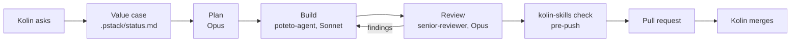
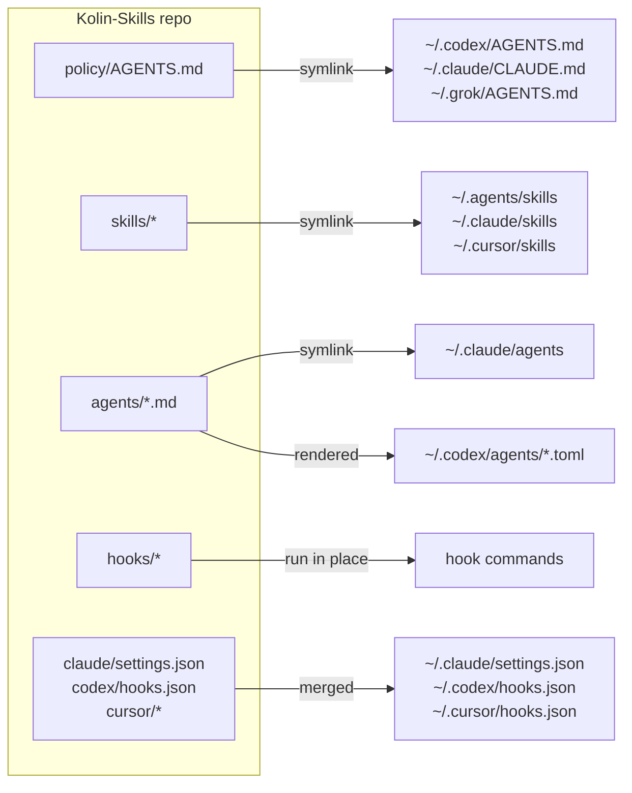

<div align="center">

# Kolin-Skills

**One repo runs every coding agent on the machine.**

Claude Code, Codex, Cursor and Grok read one policy. The skills, subagents and guardrails come from the same files.<br>
Edit a file here, and every tool has it in its next session.


</div>

---

## Why this exists

Agents do most of the coding here. Each tool ships with its own rules file, its own skills folder and its own hooks, so a rule you teach Claude Code is unknown to Codex, and a fix in one copy goes stale in the others. Prompts ask an agent to behave. Nothing stops it.

Kolin-Skills fixes both problems:

- **One source of truth.** Home folders hold only links into this repo or files rendered from it. A change here reaches every tool at once.
- **Rules that hold.** A rule lives in the strongest layer that can enforce it: a hook that blocks the action, then a test or gate that fails the push, and only then a line of prose. An agent with little context does the job right on the first try, because the wrong move does not run.

## What you get

| Layer | What it gives you | Where |
|---|---|---|
| **Policy** | One rule book for every tool: approvals, quality bar, tests, PR format, writing style | `policy/AGENTS.md` |
| **Method** | The flow from idea to release, with quality bars, on top of [Lauren Tan's pstack](https://github.com/cursor/plugins) playbooks | `skills/foundation/`, `skills/pstack-local/` |
| **Seats** | Three subagents with fixed models: Opus reviews, Sonnet builds, Haiku does mechanical sweeps | `agents/` |
| **Guardrails** | Hooks that block an unsafe action before it runs | `hooks/` |
| **Skills** | Process playbooks, UI craft, local databases, release notes, explainers | `skills/` |
| **Gate** | `kolin-skills check`: drift, strays, vendored skills, spend caps, size budgets and every test, on each push | `bin/kolin-skills` |

## Guardrails block, they do not ask

The guard hooks run on the tool call, before the action happens. A blocked agent gets a message that says why and what to do instead. The lint and compaction hooks run after.

| Hook | Tools | Runs on | Does |
|---|---|---|---|
| `hooks/gate/block-forbidden-git.sh` | Claude Code, Codex | Bash, Write, Edit | Blocks a push to `main`, `master`, `staging` or `sandbox`. A force push. `--no-verify`. Auto-merge, an API merge, or a merge into a protected branch. Agent edits to hook files. |
| `hooks/block-env-reads.py` | Claude Code, Codex (Bash only) | Bash, Read, Grep, Glob | Blocks reads of `.env` files. `.env.example` and its siblings stay readable. |
| `hooks/edit-guard.py` | Claude Code | Edit, Write | Blocks the first edit until a value case is in `.pstack/status.md`, and blocks an orchestrator that edits a 3rd file itself instead of delegating the build. |
| `hooks/agent-default-model.py` | Claude Code | Agent | Blocks a `fork` subagent. Moves an Opus builder to Sonnet unless Kolin opts in. Gives Sonnet to a subagent with no model. |
| `hooks/heavy-jobs.py` | Claude Code | Bash | Blocks sleep loops that poll, file edits through the shell, gate output piped through a filter, and Postgres in Docker. Queues heavy jobs (`test`, `build`, `tsc`, `playwright`) for one of 3 shared slots. |
| `hooks/lint-changed-lines.py` | Claude Code, Codex, Cursor | After Write, Edit, Bash | Reports lint errors on the JS and TS lines the agent just changed. |
| `hooks/compact-context.py` | Claude Code, Codex | Compaction | Gives the summary the compaction brief, then puts the branch and changed files back after it. |

The gate also holds spend caps: `check` fails when the default subagent model is not Sonnet or the compaction window is over 400k tokens.

## How a task flows



The builder never reviews its own work. Only Kolin merges to a protected branch, and the git guard makes that true for every Claude Code and Codex agent.

## Quick start

> **Fork it first.** The setup speaks for Kolin: his approvals, his branches, his writing style. Each session start pulls `main` from `origin`, so a clone of this repo keeps taking his changes. Fork it, clone your fork, then edit `policy/AGENTS.md`, `skills/foundation/SKILL.md` and the block messages in `hooks/gate/` and `hooks/heavy-jobs.py`. Keep the hooks and the gate. They are the part that makes the rules hold.

Prerequisites: git, `jq` (the git guard hook reads tool calls with it), Python >= 3.9 (`skills/pstack-local/scripts/diff-audit` uses `str.removeprefix` and the walrus operator), and Node >= 22.20 (for `npx skills`).

```sh
git clone <your-fork-url> <path>
python3 <path>/bin/kolin-skills install
```

`install` fetches the vendored upstreams at their pinned commits, installs the third-party skills, runs `apply`, then `check`. It links the CLI to `~/.local/bin/kolin-skills`. A second run of `apply` prints `already in sync`.

With an older Node, `install` prints a clear message, skips the third-party skills, and still runs `apply` and `check`. Offline, it skips each vendor it cannot fetch, links the rest, and exits 1.

## Where the rules live

| Question | Source of truth |
|---|---|
| How every agent works for Kolin: approvals, quality bar, briefs, tests, PRs, writing | `policy/AGENTS.md` |
| The flow from idea to release, Kolin's check points, the quality bars and the UI bar | `skills/foundation/SKILL.md` |
| Which pstack playbook to follow, and how pstack maps to each tool | `skills/pstack-local/SKILL.md` |
| Which model plans, builds and reviews | `skills/pstack-local/models.md` |
| Review bar for every diff | `agents/senior-reviewer.md` |
| Reply style in Claude Code | `claude/output-styles/ste-visual.md` |
| What a compaction summary keeps | `policy/compact-instructions.md` |

## Skills

`apply` links every skill flat into `~/.agents/skills`, `~/.claude/skills` and `~/.cursor/skills`, so the groups below are an index, not folders. `check` fails when this index misses a skill.

```
policy/AGENTS.md             global policy → points to foundation
skills/
  foundation/                CORE: first principles, think with Kolin, flow, check points, bars (references/ui-bar.md)
  pstack-local/              CORE: pstack adapter, models.md, scripts/diff-audit
  gap-audit/                 PROCESS: legacy repo → ranked gaps → small steps → re-audit to zero
  loop-refactor-to-pstack/   PROCESS: whole-repo program on one branch
  full-stop/, full-send/     PROCESS: approval shortcuts
  explainer/, local-supabase/, user-notes/          UTILITIES
  emil-design-eng/, break-ui/, mobile-native/       UI CRAFT
agents/                      senior-reviewer (Opus), poteto-agent (Sonnet), haiku-worker (Haiku)
upstream/                    pstack and cursor-team-kit (vendor.json), find-skills (skills.json)
```

Project rules live in each project's own `AGENTS.md`, never here.

## How a change reaches each tool



- **Edits to existing files are live at once.** Home paths are links into this repo, so every tool reads the same files.
- **New, renamed or deleted skills and agents, and settings changes,** need `kolin-skills apply`. It runs by itself:
  - at the start of each Claude Code and Codex session (`kolin-skills pull`). Cursor and Grok read the same links, so a pull from any session updates them too.
  - after `git pull`, `git checkout` and `git rebase` in this repo (`.githooks/`).
- **The session-start pull never strands a machine.** It fetches `origin/main` even when the tree has edits. On a clean tree it fast-forwards `main`, and it switches back to `main` from a branch that is already merged. When it cannot update, it prints one `kolin-skills: stale setup` line that says why.
- `apply` is idempotent. A real file it replaces goes to `~/.kolin-skills/backup/<time>/`. A link into a skill or vendor the repo dropped is removed.
- **Nothing made straight in home goes unseen.** `apply` lists every entry the repo does not own in a tool's skill, agent, command, rule, output-style or hook folder (`WATCHED_HOMES` in `bin/kolin-skills`), and each skill in `upstream/skills.json` that is not installed. `check` fails on them.
- **`kolin-skills import <path>` takes a stray in.** It moves a skill folder into `skills/` or an agent file into `agents/`. For a skill that `npx skills add` installed, it lists the package in `upstream/skills.json` and copies nothing.

## Commands

| Command | What it does |
|---|---|
| `kolin-skills apply` | Links and renders the repo into home. Offline. `--check` reports drift and changes nothing. `--adopt` moves home to this checkout when another checkout owns it. `--if-wired` does nothing unless home is wired to this checkout (the git hooks use it). |
| `kolin-skills import <path>` | Moves a skill or agent made in home into the repo, or lists an `npx skills` install in `upstream/skills.json`, then applies. |
| `kolin-skills pull` | Fetches `origin/main`, fast-forwards when it safely can, says so when it cannot, then applies. Session start runs `pull --quiet`. |
| `kolin-skills upstream` | Checks out each vendor at its pinned commit and installs missing `npx skills` packages, then applies. `--bump` moves each pin to the newest commit and prints what changed. |
| `kolin-skills check` | The gate: home drift, strays, missing third-party skills, vendor pins, spend caps, size budgets, required tools and tests. In a second checkout or worktree it skips home drift and checks the repo only. |
| `kolin-skills install` | First run on a machine: `upstream`, then `check`. |
| `context-audit` | Lists skills, tools and MCP servers that cost context in every session and went unused for 30 days. Session start prints one line when they pass 500 tokens. |

## Gate

`.githooks/pre-push` runs `kolin-skills check` (about 45 s). There is no CI. `check` also runs every test, including `tests/test_no_comments.py`, which fails on a comment line in any tracked code file.

## Layout

| Path | Owns | Lands at |
|---|---|---|
| `policy/AGENTS.md` | Global policy for every tool | `~/.codex/AGENTS.md`, `~/.claude/CLAUDE.md`, `~/.grok/AGENTS.md` |
| `policy/compact-instructions.md` | Compaction brief | `~/.codex/compact-instructions.md` |
| `skills/` | Own skills | `~/.agents/skills`, `~/.claude/skills`, `~/.cursor/skills` |
| `agents/` | Subagents. pstack's `comment-sicko` is linked from the vendor clone. | `~/.claude/agents`, `~/.codex/agents/*.toml` |
| `hooks/` | Hook scripts: git guard, `.env` read guard, changed-line lint, subagent model default, heavy-job queue, compaction context, and `skills/pstack-local/scripts/mode-reminder` (the UserPromptSubmit hook) | Run from the repo |
| `claude/` | Managed settings keys, status line, output style | `~/.claude/` |
| `codex/`, `cursor/` | Hook config and the Cursor policy rule | `~/.codex/hooks.json`, `~/.cursor/` |
| `upstream/` | Vendored (`vendor.json`) and `npx skills` (`skills.json`) sources | `~/.agents/vendor`, `~/.agents/skills` |
| `tests/` | Installer, hook and repo-rule tests | Run by `check` |

## Not managed

- Codex `config.toml`, Cursor `mcp.json` and every credential file. They hold machine paths and secrets.
- `permissions` and `autoMode` in `~/.claude/settings.json`. They are per machine and per project.
- herdr's hooks, REA's `reverse-engineer-anything` skill and claude.ai synced skills. Their installers own them, and `OTHER_INSTALLERS` in `bin/kolin-skills` lists them so `check` allows them.
- Dot-entries in watched folders, such as Claude Code's `.trash` and Codex's `.system`.

## Credits

The method is [pstack](https://github.com/cursor/plugins) by Lauren Tan, with skills from Cursor's cursor-team-kit. Both are vendored at pinned commits in `upstream/vendor.json`, never copied. `emil-design-eng` follows Emil Kowalski's UI craft.

