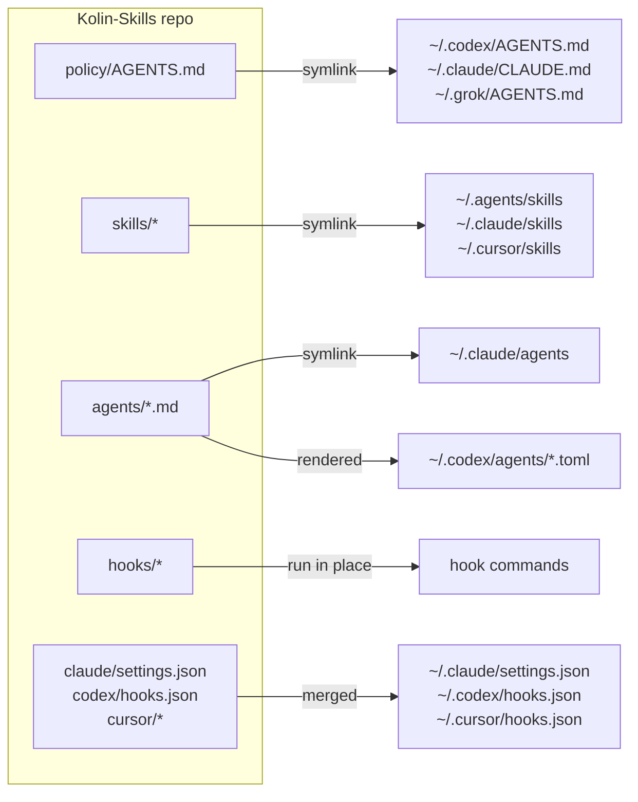

# Kolin-Skills

One repo for Kolin's agent setup. Clone it, run `install`, and every agent tool on the machine (Claude Code, Codex, Cursor, Grok) works the same way. A change here reaches every tool.

## Where the workflow is written down

| Question | Source of truth |
|---|---|
| How every agent works for Kolin: approvals, quality bar, briefs, tests, PRs, writing | `policy/AGENTS.md` |
| The flow from idea to release, Kolin's check points, the quality bars and the UI bar | `skills/foundation/SKILL.md` |
| Which pstack playbook to follow, and how pstack maps to each tool | `skills/pstack-local/SKILL.md` |
| Which model plans, builds and reviews | `skills/pstack-local/models.md` |
| Review bar for every diff | `agents/senior-reviewer.md` |
| Reply style in Claude Code | `claude/output-styles/ste-visual.md` |
| What a compaction summary keeps | `policy/compact-instructions.md` |

## Skills

`apply` links every skill flat into `~/.agents/skills`, `~/.claude/skills` and `~/.cursor/skills`, so the groups below are an index, not folders. `skills/pstack-local/SKILL.md` keeps the same index, and `check` fails when one of them misses a skill.

```
policy/AGENTS.md             global policy → points to foundation
skills/
  foundation/                CORE: first principles, think with Kolin, flow, check points, bars (references/ui-bar.md)
  pstack-local/              CORE: pstack adapter, skill index, models.md, scripts/diff-audit
  gap-audit/                 PROCESS: legacy repo → ranked gaps → small steps → re-audit to zero
  loop-refactor-to-pstack/   PROCESS: whole-repo program on one branch
  full-stop/, full-send/     PROCESS: approval shortcuts
  explainer/, local-supabase/                       UTILITIES
  emil-design-eng/, break-ui/, mobile-native/       UI CRAFT
agents/                      senior-reviewer (Opus), poteto-agent (Sonnet), haiku-worker (Haiku)
upstream/                    pstack and cursor-team-kit (vendor.json), find-skills (skills.json)
```

Project rules live in each project's own `AGENTS.md`, never here.

## How a change reaches each tool



- **Edits to existing files are live at once.** Home paths are links into this repo, so every tool reads the same files.
- **New, renamed or deleted skills and agents, and settings changes,** need `kolin-skills apply`. It runs by itself:
  - at the start of each Claude Code and Codex session (`kolin-skills pull`). Cursor and Grok read the same links, so a pull from any session updates them too.
  - after `git pull`, `git checkout` and `git rebase` in this repo (`.githooks/`).
- **The session-start pull never strands a machine.** It fetches `origin/main` even when the tree has edits. On a clean tree it fast-forwards `main`, and it switches back to `main` from a branch that is already merged. When it cannot update, it prints one `kolin-skills: stale setup` line that says why.
- `apply` is idempotent. A second run prints `already in sync`. A real file it replaces goes to `~/.kolin-skills/backup/<time>/`. A link into a skill or vendor the repo dropped is removed.
- **Nothing made straight in home goes unseen.** `apply` lists every entry the repo does not own in a tool's skill, agent, command, rule, output-style or hook folder (`WATCHED_HOMES` in `bin/kolin-skills`), and each skill in `upstream/skills.json` that is not installed. `check` fails on them.
- **`kolin-skills import <path>` takes a stray in.** It moves a skill folder into `skills/` or an agent file into `agents/`. For a skill that `npx skills add` installed, it lists the package in `upstream/skills.json` and copies nothing.

## New machine

Prerequisites: git, Python 3, `jq` (the git guard hook reads tool calls with it), and Node >= 22.20 (for `npx skills`). With an older Node, `install` prints a clear message, skips the third-party skills, and still runs `apply` and `check`. Offline, it skips each vendor it cannot fetch, links the rest, and exits 1.

```sh
git clone https://github.com/kolin-HJ/Kolin-Skills.git <path>
python3 <path>/bin/kolin-skills install
```

`install` fetches the vendored upstreams at their pinned commits, installs the third-party skills, runs `apply`, then `check`. It links the CLI to `~/.local/bin/kolin-skills`.

## Commands

| Command | What it does |
|---|---|
| `kolin-skills apply` | Links and renders the repo into home. Offline. `--check` reports drift and changes nothing. `--adopt` moves home to this checkout when another checkout owns it. `--if-wired` does nothing unless home is wired to this checkout (the git hooks use it). |
| `kolin-skills import <path>` | Moves a skill or agent made in home into the repo, or lists an `npx skills` install in `upstream/skills.json`, then applies. |
| `kolin-skills pull` | Fetches `origin/main`, fast-forwards when it safely can, says so when it cannot, then applies. Session start runs `pull --quiet`. |
| `kolin-skills upstream` | Checks out each vendor at its pinned commit and installs missing `npx skills` packages, then applies. `--bump` moves each pin to the newest commit and prints what changed. |
| `kolin-skills check` | The gate: home drift, strays, missing third-party skills, vendor pins, spend caps, size budgets, required tools and tests. In a second checkout or worktree it skips home drift and checks the repo only. |
| `kolin-skills install` | First run on a machine: `upstream`, then `check`. |
| `context-audit` | Lists skills, tools and MCP servers that cost context in every session and went unused for 30 days. Session start prints one line when they pass 500 tokens. |

## Gate

`.githooks/pre-push` runs `kolin-skills check` (about 20 s). There is no CI. `check` also runs every test, including `tests/test_no_comments.py`, which fails on a comment line in any tracked code file.

## Layout

| Path | Owns | Lands at |
|---|---|---|
| `policy/AGENTS.md` | Global policy for every tool | `~/.codex/AGENTS.md`, `~/.claude/CLAUDE.md`, `~/.grok/AGENTS.md` |
| `policy/compact-instructions.md` | Compaction brief | `~/.codex/compact-instructions.md` |
| `skills/` | Own skills | `~/.agents/skills`, `~/.claude/skills`, `~/.cursor/skills` |
| `agents/` | Subagents. pstack's `comment-sicko` is linked from the vendor clone. | `~/.claude/agents`, `~/.codex/agents/*.toml` |
| `hooks/` | Hook scripts: git guard, `.env` read guard, changed-line lint, subagent model default, heavy-job queue, compaction context | Run from the repo |
| `claude/` | Managed settings keys, status line, output style | `~/.claude/` |
| `codex/`, `cursor/` | Hook config and the Cursor policy rule | `~/.codex/hooks.json`, `~/.cursor/` |
| `upstream/` | Vendored (`vendor.json`) and `npx skills` (`skills.json`) sources | `~/.agents/vendor`, `~/.agents/skills` |
| `tests/` | Installer, hook and repo-rule tests | Run by `check` |

## Not managed

- Codex `config.toml`, Cursor `mcp.json` and every credential file. They hold machine paths and secrets.
- `permissions` and `autoMode` in `~/.claude/settings.json`. They are per machine and per project.
- herdr's hooks, REA's `reverse-engineer-anything` skill and claude.ai synced skills. Their installers own them, and `OTHER_INSTALLERS` in `bin/kolin-skills` lists them so `check` allows them.
- Dot-entries in watched folders, such as Claude Code's `.trash` and Codex's `.system`.
