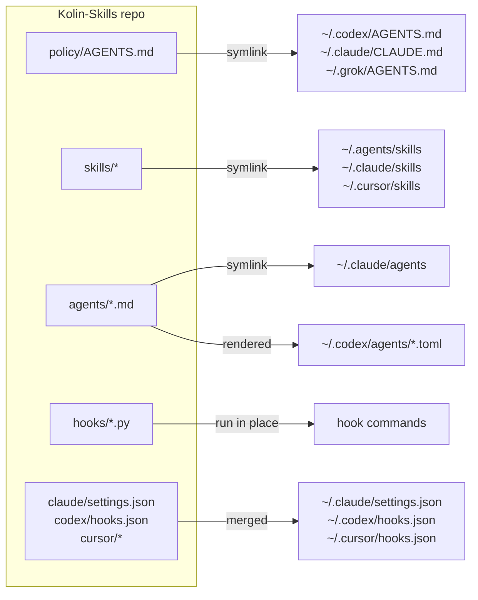

# Kolin-Skills

One repo for Kolin's agent setup. Change a file here and every harness on the machine (Claude Code, Codex, Cursor, Grok) uses the change.

## Where the workflow is written down

| Question | Source of truth |
|---|---|
| How every agent works for Kolin: approvals, quality bar, tests, PRs, writing | `policy/AGENTS.md` |
| Which method and playbook to follow (pstack), and how it maps to each harness | `skills/pstack-local/SKILL.md` |
| Which model runs each subagent role | `skills/pstack-local/models.md` |
| Review bar for every diff | `agents/senior-reviewer.md` |
| Reply style in Claude Code | `claude/output-styles/ste-visual.md` |
| What a compaction summary keeps | `policy/compact-instructions.md` |
| Approval shortcuts "full stop" and "full send" | `skills/full-stop/`, `skills/full-send/` |

## Skill structure

`skills/foundation` is the root. Every other skill inherits its flow, Kolin's check points and the quality bars. `apply` links every skill flat into `~/.agents/skills` (Codex, Grok), `~/.claude/skills` and `~/.cursor/skills`, so the groups below are an index, not folders. `skills/pstack-local/SKILL.md` keeps the same index.

```
policy/AGENTS.md            global policy → points to foundation
skills/
  foundation/               CORE: first principles, think with Kolin, flow, check points, bars (references/ui-bar.md)
  pstack-local/             CORE: pstack adapter, skill index, models.md, references/upstreams.md
  gap-audit/                PROCESS: legacy repo → ranked gaps → small steps → re-audit to zero
  loop-refactor-to-pstack/  PROCESS: whole-repo program on one branch
  full-stop/, full-send/    PROCESS: approval shortcuts
  slickjoy/                 PROJECT: SlickJoy-only rules
  local-supabase/, explainer/, emil-design-eng/, break-ui/, mobile-native/,
  pick-ui-library/, prototype/, apple-design/, ask-sonner/,
  animate/ + animation-*, *-animations/        UTILITIES
  (principles: vendored pstack principle-*)
agents/                     senior-reviewer, poteto-agent, haiku-worker, comment-sicko
```

## How a change reaches each harness



- **Edits to existing files are live at once.** Home paths are symlinks into this repo.
- **New, renamed or deleted skills and agents, and settings changes** need `kolin-skills apply`. It runs by itself:
  - at the start of each Claude Code and Codex session (`kolin-skills pull`, which fast-forwards from GitHub first when the repo has no local edits),
  - after `git pull`, `git checkout` and `git rebase` in this repo (`.githooks/`).
- `apply` is idempotent. A second run prints `already in sync`. A real file it replaces goes to `~/.kolin-skills/backup/<time>/`.
- **Nothing made straight in home goes unseen.** `apply` lists every entry the repo does not own in a harness's skill, agent, command, rule, output-style, hook or mod folder (`WATCHED_HOMES` in `bin/kolin-skills`). It also lists each skill in `upstream/skills.json` that is not installed. Session start prints the same lines, and `check` fails on them.
- **`kolin-skills import <path>` takes a stray in.** It moves a skill folder into `skills/` or an agent file into `agents/`. For a skill that `npx skills add` installed, it adds the package to `upstream/skills.json` and copies nothing. Then it applies.

## New machine

Prerequisites: git, Python 3, and Node >= 22.20 (for the `npx skills` third-party installs). With an older Node, `install` prints a clear message, skips the third-party skills, and still runs `apply` and `check`.

```sh
git clone https://github.com/kolin-HJ/Kolin-Skills.git ~/Documents/Github/Kolin-Skills   # any path works, e.g. /workspace/kolin-skills on the bot box
python3 ~/Documents/Github/Kolin-Skills/bin/kolin-skills install
```

`install` clones the vendored upstreams, installs third-party skills, runs `apply`, then `check`. It links the CLI to `~/.local/bin/kolin-skills`, so the command works wherever `~/.local/bin` is on `PATH`.

## Commands

| Command | What it does |
|---|---|
| `kolin-skills apply` | Links and renders the repo into home. Offline. `--check` reports drift and changes nothing. |
| `kolin-skills import <path>` | Moves a skill or agent made in home into the repo, or lists an `npx skills` install in `upstream/skills.json`, then applies. |
| `kolin-skills pull` | Fast-forwards from the remote when the tree is clean, then applies. The Claude and Codex session-start hooks run `pull --quiet` (fast-forward only, skipped on local edits, 10s cap, never blocks the session). |
| `kolin-skills upstream` | Updates pstack, cursor-team-kit, ponytail and the `npx skills` packages, then applies. |
| `kolin-skills check` | The gate: drift, strays in home, missing third-party skills, spend caps, size budgets, Bun, tests. |
| `kolin-skills install` | First run on a machine: `upstream`, then `check`. |
| `context-audit` | Lists skills, tools and MCP servers that cost context in every session and went unused for 30 days. The session-start hook prints one line when they pass 500 tokens and refreshes the report weekly in the background. |

## Layout

| Path | Owns | Lands at |
|---|---|---|
| `policy/AGENTS.md` | Global policy for every harness | `~/.codex/AGENTS.md`, `~/.claude/CLAUDE.md`, `~/.grok/AGENTS.md` |
| `policy/compact-instructions.md` | Compaction brief | `~/.codex/compact-instructions.md` |
| `skills/` | Own skills, including the `pstack-local` adapter | `~/.agents/skills`, `~/.claude/skills`, `~/.cursor/skills` |
| `agents/` | Subagents | `~/.claude/agents`, `~/.codex/agents/*.toml` |
| `hooks/` | Hook scripts | Run from the repo; old home paths stay as links |
| `claude/` | Managed settings keys, status line, output style | `~/.claude/` |
| `codex/`, `cursor/` | Hook config and the Cursor policy rule | `~/.codex/hooks.json`, `~/.cursor/` |
| `mods/` | Claude Code mods `usage-band` and `savvy-progress` | `~/.claude/mods/` |
| `evals/` | Agent eval cases and results | `~/.agents/evals` |
| `upstream/` | Vendored and third-party skill sources | `~/.agents/vendor`, `npx skills`. Vendored skills link into `~/.agents/skills` and `~/.claude/skills`. From ponytail, only `ponytail` and `ponytail-audit` link (`VENDOR_SKILL_DIRS`). |
| `tests/` | Hook and apply tests | Run by `check` |

## Not managed

- Codex `config.toml`, Cursor `mcp.json` and every credential file. They hold machine paths and secrets.
- `permissions` and `autoMode` in `~/.claude/settings.json`. They are per machine and per project.
- herdr's hooks, REA's `reverse-engineer-anything` skill and claude.ai synced skills. Their installers own them, and `OTHER_INSTALLERS` in `bin/kolin-skills` lists them so `check` allows them.
- Dot-entries in watched folders, such as Claude Code's `.trash` and Codex's `.system`. The harness owns them.
