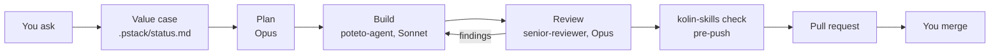
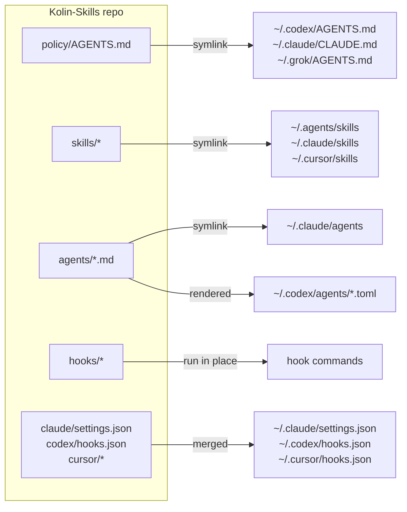

<div align="center">

# Kolin-Skills

**One setup for every coding agent you use.**

Claude Code, Codex, Cursor and Grok follow one set of rules, from one repo.<br>
Edit a file here, and every tool has it in its next session.


</div>

## What it is

Each agent tool keeps its own rules file, its own skills folder and its own hooks. A rule you teach Claude Code is unknown to Codex. A rule you write in a prompt is a request, and nothing makes the agent follow it.

Kolin-Skills keeps all of it in one repo and links it into each tool:

```
                  Kolin-Skills repo
     policy  ·  skills  ·  subagents  ·  hooks
                          │
              linked into each tool's home
       ┌────────────┬─────┴──────┬────────────┐
  Claude Code     Codex        Cursor        Grok
```

Claude Code gets all of it. Codex gets the policy, the skills, the subagents, and the git, `.env`, lint and compaction hooks. Cursor gets a policy rule, the skills and the lint hook. Grok gets the policy and the skills.

| Part | What it gives you |
|---|---|
| **Policy** | One rule book: when the agent asks first, the quality bar, tests, PR format and writing style. |
| **Skills** | Playbooks the agent loads when your request matches: fix a bug, audit a repo, polish a UI, write release notes. |
| **Subagents** | A builder, a reviewer and a sweeper. The agent that writes the code never reviews it. |
| **Guardrails** | Hooks that block a risky action before it runs: a push to `main`, a force push, a read of `.env`. |
| **Gate** | One command, `kolin-skills check`, that runs before every push. |

## Get started

You need git, `jq`, Python >= 3.9 and Node >= 22.20. Without `jq`, the git guard blocks every shell command.

1. **Fork this repo.** The rules in it are Kolin's. Each session pulls `main` from `origin`, so a plain clone keeps taking his changes.
2. **Clone your fork and install.**

   ```sh
   git clone <your-fork-url> ~/Kolin-Skills
   python3 ~/Kolin-Skills/bin/kolin-skills install
   ```

   `install` fetches the vendored skills at pinned commits, installs the `npx skills` ones, links everything into each tool's home, then runs `check`. It also puts `kolin-skills` in `~/.local/bin`.
3. **Open any agent in any repo and ask for the work.** There is nothing to start.
4. **Make the rules yours.** Edit `policy/AGENTS.md` and `skills/foundation/SKILL.md`, and the block messages in `hooks/gate/` and `hooks/heavy-jobs.py` that name Kolin. Make each change on a branch and merge it through a PR. Keep the hooks and the gate. They are what makes the rules hold.

With Node older than 22.20, `install` skips the third-party skills and says so. Offline, it links what it has and exits 1.

## How it works

### One source of truth

Home folders hold only links into this repo, or files rendered from it. An edit to an existing file is live at once. Each Claude Code and Codex session starts with `kolin-skills pull`, which takes the latest `main` and links anything new.

### Every task follows one flow

In Claude Code and Codex, each prompt reminds the agent to read the method (`poteto-mode`, `pstack-local` and `foundation`) and to write a value case before its first edit.



For multi-phase work, the agent waits for your yes on the plan before it builds. The models shown are the Claude Code seats. Codex runs both subagents on its default model.

### Guardrails block, they do not ask

A blocked agent gets a message that says why and what to do instead. The hooks stop:

- A push to `main`, `master`, `staging` or `sandbox`, a force push, `--no-verify`, auto-merge, an API merge, and any merge into a protected branch.
- A read of a `.env` file.
- The first edit before a value case exists.
- Sleep loops that poll, file edits through the shell, and gate output piped through a filter.

Claude Code runs every hook. Codex runs the git and `.env` guards. Cursor runs the lint hook. The Hooks block under [Reference](#reference) has the full list.

### One gate before every push

`.githooks/pre-push` runs `kolin-skills check` (about 45 s). There is no CI. `check` fails on drift between home and the repo, a skill made straight in home, a missing third-party skill, a spend cap that is off, a file over its size budget, a failed test, or a comment in code. The [Commands](#reference) block has the full list.

## Use it

Ask for the outcome in plain words. The agent loads a skill when your request matches the skill's description. You can also call a skill by name, such as `/gap-audit`.

| Say | Skill |
|---|---|
| "Fix the redirect bug on login" | `poteto-mode` bug-fix playbook: reproduce it first, then the smallest fix |
| "Audit this repo" or "bring it up to standard" | `gap-audit` |
| "Stress-test this table" | `break-ui` |
| "Make this drawer feel polished" | `emil-design-eng` |
| "It feels wrong on my phone" | `mobile-native` |
| "Start a local database" | `local-supabase` |
| "Write release notes for PR 42" | `user-notes` |
| "Explain this PR visually" | `explainer` |

To hand off a whole PR, say one of two phrases. In Claude Code, an agent cannot start either one by itself.

| Say | The agent | It stops at |
|---|---|---|
| "full stop" or `/full-stop` | Branches, proves the failure, makes the fix, opens a draft PR, then fixes failed checks and answers review comments | A PR that is ready to merge. You merge. |
| "full send" or `/full-send` | Does all of full stop, then runs a 7-item merge gate | The merge of that one PR. Into a protected branch, the git guard blocks the merge and the agent gives you the command to run. It never deploys, and the yes does not carry to another PR. |

For a whole-repo refactor over many sessions, type `/loop-refactor-to-pstack`.

To change a rule, edit it here on a work branch and open a PR. Each machine takes the change at the next session start after the merge. To add a skill, an agent or a hook, follow the "Add something" table in `AGENTS.md`.

## Reference

<details>
<summary><b>Skills index</b></summary>

`apply` links every skill flat into `~/.agents/skills`, `~/.claude/skills` and `~/.cursor/skills`, so the groups below are an index, not folders. `check` fails when this index misses a skill.

```
policy/AGENTS.md             global policy → points to foundation
skills/
  foundation/                CORE: first principles, think with Kolin, flow, check points, bars (references/ui-bar.md)
  pstack-local/              CORE: pstack adapter, models.md, scripts/diff-audit, scripts/pr-body
  gap-audit/                 PROCESS: legacy repo → ranked gaps → small steps → re-audit to zero
  loop-refactor-to-pstack/   PROCESS: whole-repo program on one branch
  full-stop/, full-send/     PROCESS: approval shortcuts
  explainer/, local-supabase/, user-notes/          UTILITIES
  emil-design-eng/, break-ui/, mobile-native/       UI CRAFT
agents/                      senior-reviewer (Opus), poteto-agent (Sonnet), haiku-worker (Haiku)
upstream/                    pstack and cursor-team-kit (vendor.json), find-skills (skills.json)
```

Project rules live in each project's own `AGENTS.md`, never here.

</details>

<details>
<summary><b>Hooks</b></summary>

The guard hooks run on the tool call, before the action happens. The lint and compaction hooks run after.

| Hook | Tools | Runs on | Does |
|---|---|---|---|
| `hooks/gate/block-forbidden-git.sh` | Claude Code, Codex | Bash, Write, Edit | Blocks a push to `main`, `master`, `staging` or `sandbox`. A force push. `--no-verify`. Auto-merge, an API merge, or a merge into a protected branch. Agent edits to hook files. |
| `hooks/block-env-reads.py` | Claude Code, Codex (Bash only) | Bash, Read, Grep, Glob | Blocks reads of `.env` files. `.env.example` and its siblings stay readable. |
| `hooks/edit-guard.py` | Claude Code | Edit, Write | Blocks the first edit until a value case is in `.pstack/status.md`, and blocks an orchestrator that edits a 3rd file itself instead of delegating the build. |
| `hooks/agent-default-model.py` | Claude Code | Agent | Blocks a `fork` subagent. Moves an Opus builder to Sonnet unless Kolin opts in. Gives Sonnet to a subagent with no model. |
| `hooks/heavy-jobs.py` | Claude Code | Bash | Blocks sleep loops that poll, file edits through the shell, gate output piped through a filter, and Postgres in Docker. Queues heavy jobs (`test`, `build`, `tsc`, `playwright`) for one of 3 shared slots. |
| `hooks/lint-changed-lines.py` | Claude Code, Codex, Cursor | After Write, Edit, Bash | Reports lint errors on the JS and TS lines the agent just changed. |
| `hooks/compact-context.py` | Claude Code, Codex | Compaction | Gives the summary the compaction brief, then puts the branch and changed files back after it. |
| `skills/pstack-local/scripts/mode-reminder` | Claude Code, Codex | Each prompt | Reminds the agent to read the method and write a value case. Flags "full stop" and "full send". |

The gate also holds spend caps: `check` fails when the default subagent model is not Sonnet or the compaction window is over 400k tokens.

</details>

<details>
<summary><b>Commands</b></summary>

| Command | What it does |
|---|---|
| `kolin-skills apply` | Links and renders the repo into home. Offline. `--check` reports drift and changes nothing. `--adopt` moves home to this checkout when another checkout owns it. `--if-wired` does nothing unless home is wired to this checkout (the git hooks use it). |
| `kolin-skills import <path>` | Moves a skill or agent made in home into the repo, or lists an `npx skills` install in `upstream/skills.json`, then applies. |
| `kolin-skills pull` | Fetches `origin/main`, fast-forwards when it safely can, says so when it cannot, then applies. Session start runs `pull --quiet`. |
| `kolin-skills upstream` | Checks out each vendor at its pinned commit and installs missing `npx skills` packages, then applies. `--bump` moves each pin to the newest commit and prints what changed. |
| `kolin-skills check` | The gate: home drift, strays, missing third-party skills, vendor pins, spend caps, size budgets, required tools and tests. In a second checkout or worktree it skips home drift and checks the repo only. |
| `kolin-skills install` | First run on a machine: `upstream`, then `check`. |
| `context-audit` | Lists skills, tools and MCP servers that cost context in every session and went unused for 30 days. Session start prints one line when they pass 500 tokens. |

</details>

<details>
<summary><b>How a change reaches each tool</b></summary>



- **Edits to existing files are live at once.** Home paths are links into this repo, so every tool reads the same files.
- **New, renamed or deleted skills and agents, and settings changes,** need `kolin-skills apply`. It runs by itself:
  - at the start of each Claude Code and Codex session (`kolin-skills pull`). Cursor and Grok read the same links, so a pull from any session updates them too.
  - after `git pull`, `git checkout` and `git rebase` in this repo (`.githooks/`).
- **The session-start pull never strands a machine.** It fetches `origin/main` even when the tree has edits. On a clean tree it fast-forwards `main`, and it switches back to `main` from a branch that is already merged. When it cannot update, it prints one `kolin-skills: stale setup` line that says why.
- `apply` is idempotent. A second run prints `already in sync`. A real file it replaces goes to `~/.kolin-skills/backup/<time>/`. A link into a skill or vendor the repo dropped is removed.
- **Nothing made straight in home goes unseen.** `apply` lists every entry the repo does not own in a tool's skill, agent, command, rule, output-style or hook folder (`WATCHED_HOMES` in `bin/kolin-skills`), and each skill in `upstream/skills.json` that is not installed. `check` fails on them.
- **`kolin-skills import <path>` takes a stray in.** It moves a skill folder into `skills/` or an agent file into `agents/`. For a skill that `npx skills add` installed, it lists the package in `upstream/skills.json` and copies nothing.

</details>

<details>
<summary><b>Where the rules live</b></summary>

| Question | Source of truth |
|---|---|
| How every agent works for Kolin: approvals, quality bar, briefs, tests, PRs, writing | `policy/AGENTS.md` |
| The flow from idea to release, Kolin's check points, the quality bars and the UI bar | `skills/foundation/SKILL.md` |
| Which pstack playbook to follow, and how pstack maps to each tool | `skills/pstack-local/SKILL.md` |
| Which model plans, builds and reviews | `skills/pstack-local/models.md` |
| Review bar for every diff | `agents/senior-reviewer.md` |
| Reply style in Claude Code | `claude/output-styles/ste-visual.md` |
| What a compaction summary keeps | `policy/compact-instructions.md` |

</details>

<details>
<summary><b>Layout</b></summary>

| Path | Owns | Lands at |
|---|---|---|
| `policy/AGENTS.md` | Global policy for every tool | `~/.codex/AGENTS.md`, `~/.claude/CLAUDE.md`, `~/.grok/AGENTS.md` |
| `policy/compact-instructions.md` | Compaction brief | `~/.codex/compact-instructions.md` |
| `skills/` | Own skills | `~/.agents/skills`, `~/.claude/skills`, `~/.cursor/skills` |
| `agents/` | Subagents. pstack's `comment-sicko` is linked from the vendor clone. | `~/.claude/agents`, `~/.codex/agents/*.toml` |
| `hooks/` | Hook scripts: git guard, `.env` read guard, changed-line lint, subagent model default, heavy-job queue, compaction context, and `skills/pstack-local/scripts/mode-reminder` (the UserPromptSubmit hook) | Run from the repo |
| `claude/` | Managed settings keys, status line, output style | `~/.claude/` |
| `codex/`, `cursor/` | Hook config and the Cursor policy rule | `~/.codex/hooks.json`, `~/.cursor/` |
| `upstream/` | Vendored (`vendor.json`) and `npx skills` (`skills.json`) sources | `~/.agents/vendor`, `~/.agents/skills` |
| `tests/` | Installer, hook and repo-rule tests | Run by `check` |

</details>

<details>
<summary><b>Not managed</b></summary>

- Codex `config.toml`, Cursor `mcp.json` and every credential file. They hold machine paths and secrets.
- `permissions` and `autoMode` in `~/.claude/settings.json`. They are per machine and per project.
- herdr's hooks, REA's `reverse-engineer-anything` skill and claude.ai synced skills. Their installers own them, and `OTHER_INSTALLERS` in `bin/kolin-skills` lists them so `check` allows them.
- Dot-entries in watched folders, such as Claude Code's `.trash` and Codex's `.system`.

</details>

## Credits

The method is [pstack](https://github.com/cursor/plugins) by Lauren Tan, with skills from Cursor's cursor-team-kit. Both are vendored at pinned commits in `upstream/vendor.json`, never copied. `emil-design-eng` follows Emil Kowalski's UI craft.
