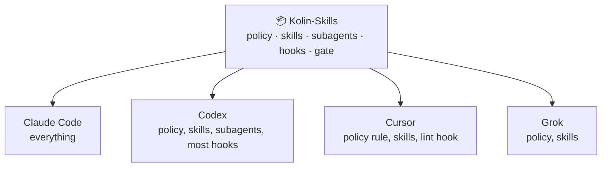
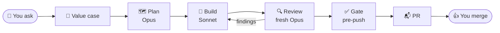

<div align="center">

# Kolin-Skills

**One rule book for every coding agent you use.**

Claude Code, Codex, Cursor and Grok follow the same rules, skills and guardrails, from one repo.


[What](#what-it-is) · [Why](#why-use-it) · [How it works](#how-it-works) · [Install](#install) · [Quality](#what-quality-means) · [Daily use](#working-with-it)

</div>

## What it is

One repo holds your agent setup. Each tool's home folder only links to it, so one edit reaches every tool.



| Part | What it gives you |
|---|---|
| 📜 **Policy** | One rule book: when to ask, the quality bar, tests, PR format, writing style |
| 🧰 **Skills** | Playbooks that load when your request matches: fix a bug, audit a repo, polish a UI |
| 🤖 **Subagents** | A builder, a reviewer and a sweeper. The builder never reviews its own code |
| 🛡️ **Guardrails** | Hooks that block a risky action before it runs |
| ✅ **Gate** | `kolin-skills check`, run before every push |

## Why use it

| Without it | With it |
|---|---|
| Each tool has its own rules file | One rule book in every tool |
| A rule in a prompt is only a request | A hook blocks the action, and the gate fails the push |
| The agent reviews its own code | A fresh reviewer reads every diff |
| "Done" means it compiles | "Done" means proven on the real app |
| The same mistake comes back | Each mistake becomes a lint rule, a test or a type |

## How it works

Every task follows one flow. In Claude Code, each prompt reminds the agent to write a value case first, and a hook blocks the first edit until it exists.



The models are the Claude Code seats. Codex runs both subagents on its default model.

**Guardrails block. They do not ask.** The blocked agent gets the reason and the fix.

| 🚫 Blocked | Why |
|---|---|
| Push to `main`, `master`, `staging`, `sandbox`; force push; `--no-verify`; auto-merge | Protected branches change only through a PR you merge |
| Reading a `.env` file | Secrets stay out of the context |
| First edit before a value case | No outcome, no code |
| Sleep loops, edits through the shell, filtered gate output | Agents see the real output and use the real tools |

Claude Code runs every guard. Codex runs the git and `.env` guards. Cursor runs only the lint hook, and Grok runs no hooks.

## Install

You need **git**, **`jq`**, **Python ≥ 3.9** and **Node ≥ 22.20**. Without `jq`, the git guard blocks every shell command.

```sh
git clone <your-fork-url> ~/Kolin-Skills
python3 ~/Kolin-Skills/bin/kolin-skills install
```

1. **Fork first.** Each Claude Code and Codex session pulls `main` from `origin`, so a plain clone keeps taking Kolin's changes.
2. **Run `install`.** It fetches the pinned third-party skills, links everything into each tool, runs `check` and puts `kolin-skills` in `~/.local/bin`.
3. **Open any agent in any repo.** There is nothing to start.
4. **Make it yours.** Edit `policy/AGENTS.md`, `skills/foundation/SKILL.md` and the block messages in `hooks/gate/` and `hooks/heavy-jobs.py`. Keep the hooks and the gate. They are what makes the rules hold.

With Node older than 22.20, `install` skips the third-party skills and says so. Offline, it links what it has and exits 1.

## What quality means

> **The most value for the least code**, at the same bar for correctness, tests and proof.

| Bar | Check |
|---|---|
| 🎯 **Earns its place** | Every file, test and dependency answers "what breaks if this goes?" |
| ✂️ **Small** | The smallest change that fixes the root cause. Files near 400 lines, never over 1,000 |
| 🏠 **One home** | One concept lives in one module. Extend the owner, no parallel helper |
| 🔒 **Typed** | Strict mode. No `any`, no cast, no non-null assertion |
| 🧪 **Tested** | Each behavior a caller relies on. The test fails first, then fails again on a one-line mutation |
| 👀 **Reviewed** | By an agent that did not write the code |
| 📸 **Proven** | Run on the real app, with the output pasted |

Each lesson goes into the strongest layer that can hold it:

```
 strongest ─▶  1. Code that makes the bad state impossible (a type, one paved path)
               2. A gate: a lint rule or test, with a count that can only fall
               3. A skill or AGENTS.md, for judgment no tool can check
 weakest ───▶  4. Review
```

The full bar: [`policy/AGENTS.md`](policy/AGENTS.md) and [`skills/foundation/SKILL.md`](skills/foundation/SKILL.md).

## Working with it

Ask for the outcome in plain words. The agent does the reversible work alone and waits for you only at the points that matter.

| 🤖 The agent does it alone | 🙋 It waits for your yes |
|---|---|
| Read, edit, test, review, fix | A multi-phase plan, before the build |
| Commit, push and open a PR on a work branch | A new data structure or system flow |
| | A merge, a deploy, a migration |
| | Money, secrets, messages to people |

| Say | Skill |
|---|---|
| "Fix the redirect bug on login" | `poteto-mode` bug fix: reproduce first, then the smallest fix |
| "Audit this repo" | `gap-audit` |
| "Stress-test this table" | `break-ui` |
| "Make this drawer feel polished" | `emil-design-eng` |
| "It feels wrong on my phone" | `mobile-native` |
| "Start a local database" | `local-supabase` |
| "Write release notes for PR 42" | `user-notes` |
| "Explain this PR visually" | `explainer` |

**Hand off a whole PR** with one phrase. In Claude Code, an agent cannot start either one by itself.

| Say | The agent stops at |
|---|---|
| "full stop" or `/full-stop` | A PR that is ready to merge. You merge |
| "full send" or `/full-send` | The merge of that one PR, after a 7-item merge gate. It never deploys |

For a whole-repo refactor over many sessions, type `/loop-refactor-to-pstack`. To change a rule, edit it here on a branch and open a PR. Each machine takes it at the next session start. To add a skill, agent or hook, see `AGENTS.md`.

## Reference

<details>
<summary><b>Skills index and layout</b></summary>

`apply` links every skill flat into `~/.agents/skills`, `~/.claude/skills` and `~/.cursor/skills`. `check` fails when this index misses a skill.

```
policy/AGENTS.md             global policy → ~/.claude/CLAUDE.md, ~/.codex/AGENTS.md, ~/.grok/AGENTS.md
policy/compact-instructions.md   what a compaction summary keeps
skills/
  foundation/                CORE: first principles, flow, check points, quality and UI bars
  pstack-local/              CORE: pstack adapter, models.md (which model plans, builds, reviews), scripts/diff-audit, scripts/pr-body
  gap-audit/                 PROCESS: legacy repo → ranked gaps → small steps → re-audit to zero
  loop-refactor-to-pstack/   PROCESS: whole-repo program on one branch
  full-stop/, full-send/     PROCESS: approval shortcuts
  explainer/, local-supabase/, user-notes/          UTILITIES
  emil-design-eng/, break-ui/, mobile-native/       UI CRAFT
agents/                      senior-reviewer (Opus, the review bar), poteto-agent (Sonnet), haiku-worker (Haiku)
hooks/                       guards and lint, run in place from the repo
claude/                      managed settings keys, status line, output style (ste-visual)
codex/, cursor/              hook config and the Cursor policy rule
.githooks/                   pre-push runs check; post-merge, post-checkout, post-rewrite run apply
upstream/                    pstack and cursor-team-kit (vendor.json), npx skills (skills.json)
tests/                       installer, hook and repo-rule tests, run by check
```

Edits to existing files are live at once. A new, renamed or deleted skill or agent needs `apply`, which runs by itself at session start and after `git pull`, `checkout` and `rebase` here. `apply` is idempotent, and a real file it replaces goes to `~/.kolin-skills/backup/`.

Project rules live in each project's own `AGENTS.md`, never here. Not managed: credentials, Codex `config.toml`, Cursor `mcp.json`, and `permissions` and `autoMode` in `~/.claude/settings.json`.

</details>

<details>
<summary><b>Commands</b></summary>

| Command | What it does |
|---|---|
| `kolin-skills install` | First run on a machine: `upstream`, then `check` |
| `kolin-skills apply` | Links the repo into home. `--check` reports drift only. `--adopt` moves home to this checkout. `--if-wired` runs only when home is wired here |
| `kolin-skills pull` | Fetches `origin/main`, fast-forwards when it safely can, then applies. Runs at each Claude Code and Codex session start, and prints `kolin-skills: stale setup` when it cannot update |
| `kolin-skills upstream` | Installs third-party skills at pinned commits. `--bump` moves the pins |
| `kolin-skills import <path>` | Moves a skill or agent made in home into the repo |
| `kolin-skills check` | The gate: drift, strays, pins, spend caps, size budgets, tools, tests, comments. In a worktree it skips home drift |
| `context-audit` | Lists skills, tools and MCP servers that cost context and went unused for 30 days |

</details>

<details>
<summary><b>Hooks</b></summary>

| Hook | Tools | Does |
|---|---|---|
| `hooks/gate/block-forbidden-git.sh` | Claude Code, Codex | Blocks protected-branch pushes and merges, force push, `--no-verify`, auto-merge, edits to hook files |
| `hooks/block-env-reads.py` | Claude Code, Codex | Blocks `.env` reads. `.env.example` stays readable |
| `hooks/edit-guard.py` | Claude Code | Blocks the first edit until `.pstack/status.md` has a value case, and an orchestrator that builds instead of delegating |
| `hooks/agent-default-model.py` | Claude Code | Blocks `fork` subagents. Moves an Opus builder to Sonnet |
| `hooks/heavy-jobs.py` | Claude Code | Blocks polling loops and shell edits. Queues heavy jobs into 3 shared slots |
| `hooks/lint-changed-lines.py` | All but Grok | Lints the JS and TS lines the agent just changed |
| `hooks/compact-context.py` | Claude Code, Codex | Keeps the branch and changed files through compaction |
| `skills/pstack-local/scripts/mode-reminder` | Claude Code, Codex | Each prompt: read the method, write a value case. Flags "full stop" and "full send" |

</details>

## Credits

The method is [pstack](https://github.com/cursor/plugins) by Lauren Tan, with skills from Cursor's cursor-team-kit. Both are vendored at pinned commits in `upstream/vendor.json`, never copied. `emil-design-eng` follows Emil Kowalski's UI craft.
